# Online Pharmacy Store

## Project Overview

Online Pharmacy Store is a Java web application that allows customers to browse medicines, register accounts, log in, manage a shopping cart and complete a demonstration checkout.

The application also provides an administrator section for managing the medicine catalogue.

This project was developed as part of my practical learning in Java web development.

## Technologies Used

- Java 17
- Jakarta EE 10
- Java Servlets
- JavaServer Pages (JSP)
- JSTL
- HTML
- CSS
- Apache Tomcat 10
- Maven
- NetBeans IDE

## Features

### Customer Features

- Customer registration and login.
- Password hashing using PBKDF2.
- Browse available medicines.
- Filter medicines by category.
- Add medicines to the shopping cart.
- Select medicine quantities.
- Increase and decrease item quantities.
- Remove items from the cart.
- Calculate item subtotals and the grand total.
- Demonstration checkout.

### Administrator Features

- Secure administrator login.
- Access-controlled administrator dashboard.
- Add new medicines.
- Delete existing medicines.
- Manage the medicine catalogue.

## Security

- Passwords are hashed using PBKDF2WithHmacSHA256.
- Administrator credentials are configured using environment variables.
- Administrator pages and actions are protected using an authentication filter.
- Session IDs are renewed after successful login.
- Customer accounts do not have administrator privileges.

## Project Structure

The project uses a simple layered structure:

- **Controller:** Handles HTTP requests and application actions.
- **Model:** Contains application data classes.
- **Service:** Handles medicine-related operations.
- **Filter:** Controls access to administrator functionality.
- **Util:** Contains utility classes such as password hashing.
- **Web Pages:** Contains JSP pages, HTML and CSS.

## Running the Project

1. Install JDK 17.
2. Install Apache Tomcat 10.
3. Open the project in NetBeans.
4. Build the project using Maven.
5. Configure the administrator username and password using these environment variables:

   - `PHARMACY_ADMIN_USERNAME`
   - `PHARMACY_ADMIN_PASSWORD`

6. Deploy the generated WAR file to Tomcat.
7. Start Tomcat and open the application in a browser.

## Current Limitations

- Application data is stored in memory.
- User accounts are not permanently stored.
- Medicine changes are lost when the application restarts.
- Shopping cart and order information are not permanently stored.
- Checkout is a demonstration and does not process real payments.
- No database integration is currently implemented.

## Future Improvements

- Integrate a MySQL database.
- Store customer accounts and medicine information permanently.
- Implement persistent order management.
- Add real payment gateway integration.
- Improve application testing.

## Learning Objectives

This project helped me practise:

- Java web application development.
- Servlet request and response handling.
- JSP and JSTL.
- Session management.
- Object-oriented programming.
- Authentication and access control.
- Password hashing.
- Maven project management.
- Deploying # Online Pharmacy Store

## Project Overview

Online Pharmacy Store is a Java web application that allows customers to browse medicines, register accounts, log in, manage a shopping cart and complete a demonstration checkout.

The application also provides an administrator section for managing the medicine catalogue.

This project was developed as part of my practical learning in Java web development.

## Application Screenshots

### 1. Customer Interface

**Login Page**

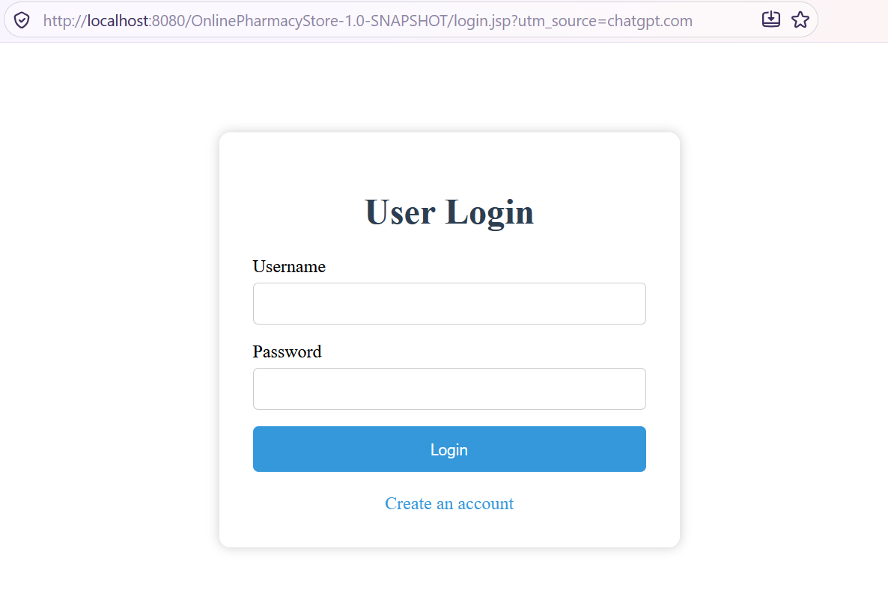

**Welcome Page**

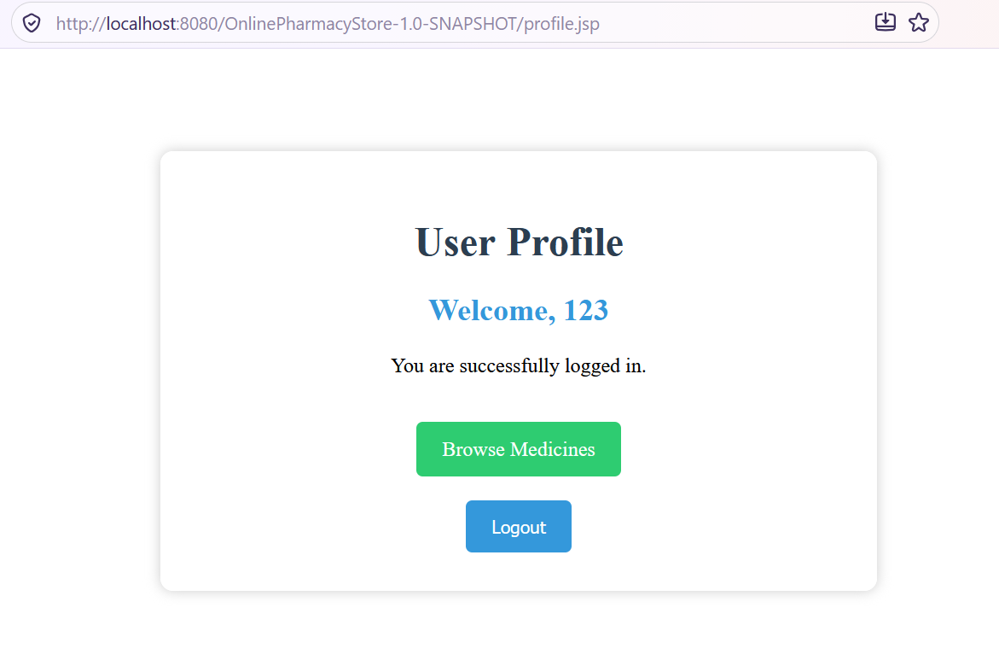

**Available Medicines**

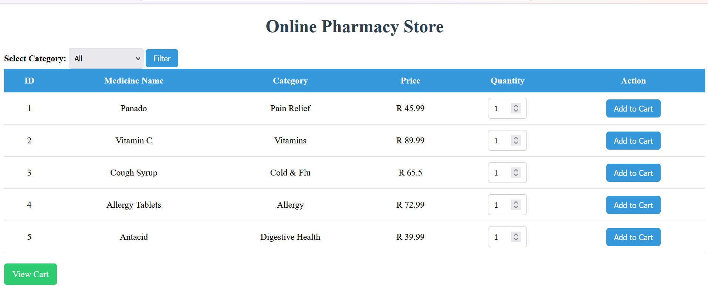

**Shopping Cart**

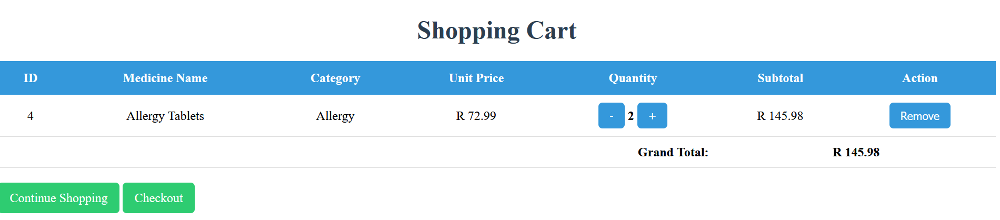

**Checkout**

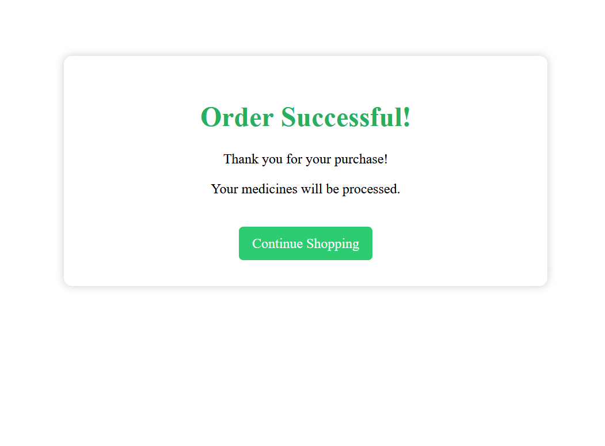

### 2. Registration and Validation

**Successful Customer Registration**

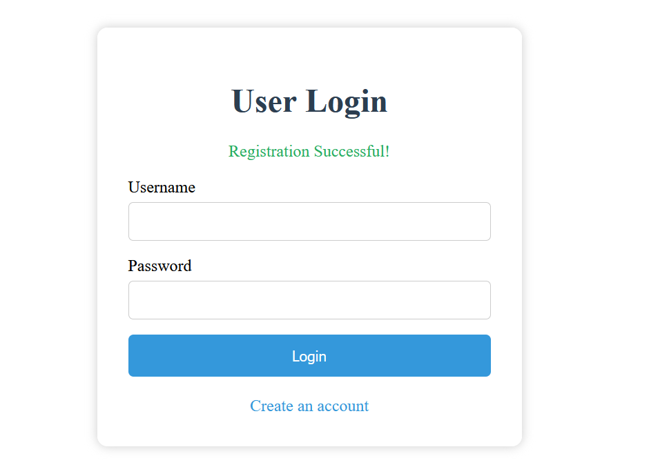

**Empty Login Fields Validation**

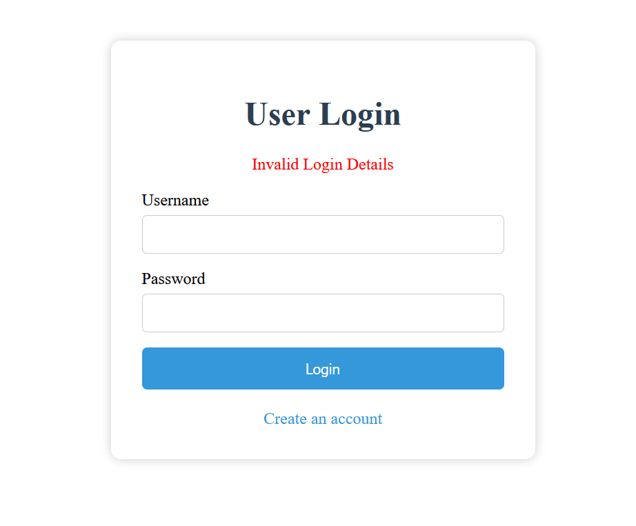

**Customer Registration**

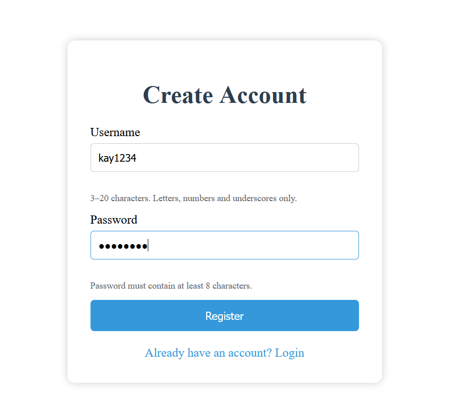

**Duplicate Customer Registration**

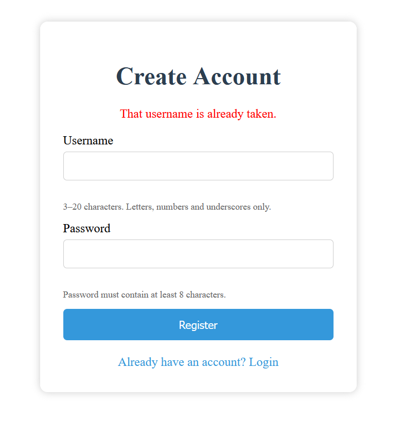

### 3. Administrator Interface

**Administrator Login**

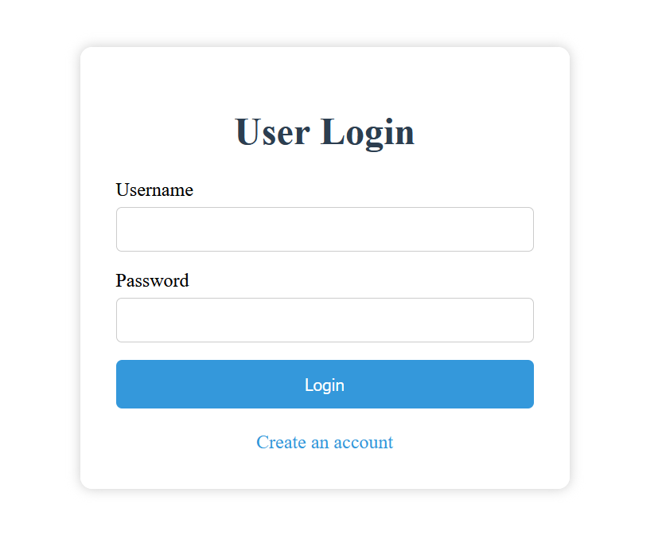

**Administrator Dashboard**

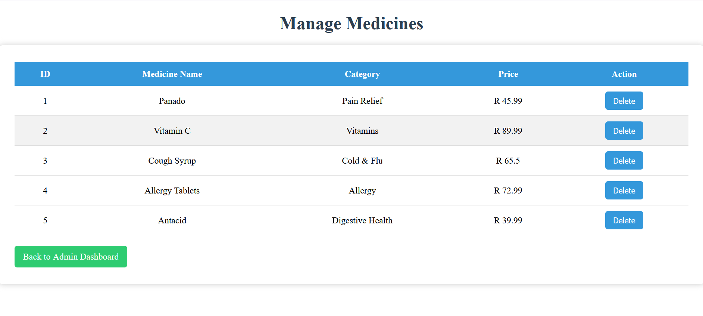

**Manage Medicines**

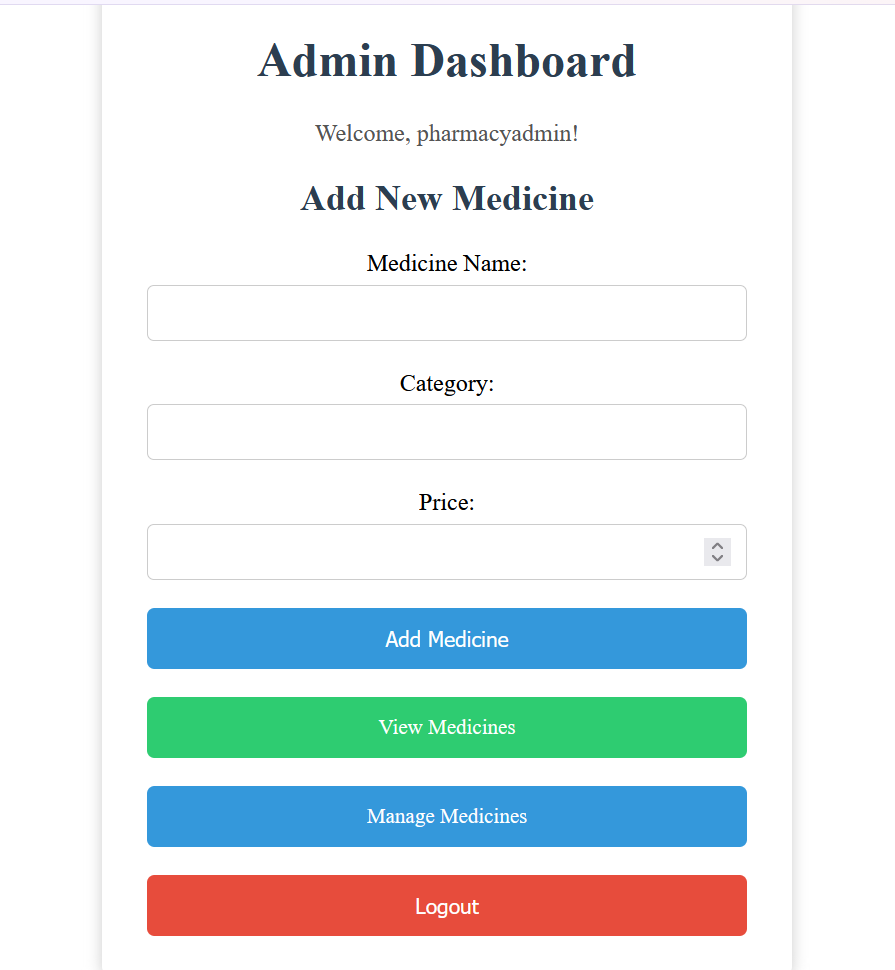

**Unauthorized Access Protection**

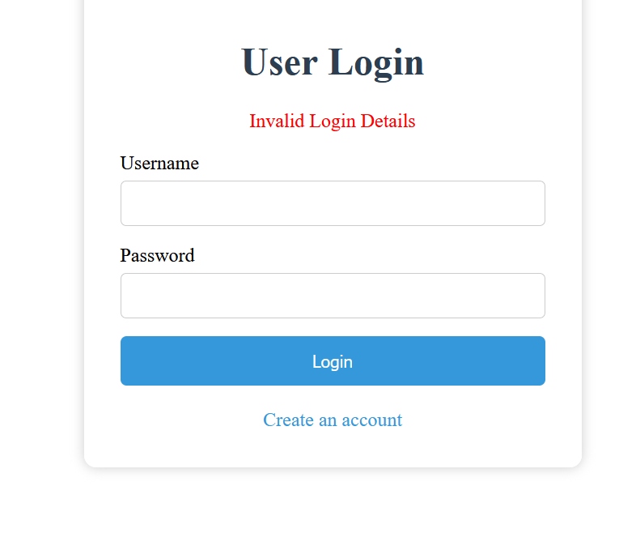

## Technologies Used

- Java 17
- Jakarta EE 10
- Java Servlets
- JavaServer Pages (JSP)
- JSTL
- HTML
- CSS
- Apache Tomcat 10
- Maven
- NetBeans IDE

## Features

### Customer Features

- Customer registration and login.
- Password hashing using PBKDF2.
- Browse available medicines.
- Filter medicines by category.
- Add medicines to the shopping cart.
- Select medicine quantities.
- Increase and decrease item quantities.
- Remove items from the cart.
- Calculate item subtotals and the grand total.
- Demonstration checkout.

### Administrator Features

- Secure administrator login.
- Access-controlled administrator dashboard.
- Add new medicines.
- Delete existing medicines.
- Manage the medicine catalogue.

## Security

- Passwords are hashed using PBKDF2WithHmacSHA256.
- Administrator credentials are configured using environment variables.
- Administrator pages and actions are protected using an authentication filter.
- Session IDs are renewed after successful login.
- Customer accounts do not have administrator privileges.

## Project Structure

The project uses a simple layered structure:

- **Controller:** Handles HTTP requests and application actions.
- **Model:** Contains application data classes.
- **Service:** Handles medicine-related operations.
- **Filter:** Controls access to administrator functionality.
- **Util:** Contains utility classes such as password hashing.
- **Web Pages:** Contains JSP pages, HTML and CSS.

## Running the Project

1. Install JDK 17.
2. Install Apache Tomcat 10.
3. Open the project in NetBeans.
4. Build the project using Maven.
5. Configure the administrator username and password using these environment variables:

   - `PHARMACY_ADMIN_USERNAME`
   - `PHARMACY_ADMIN_PASSWORD`

6. Deploy the generated WAR file to Tomcat.
7. Start Tomcat and open the application in a browser.

## Current Limitations

- Application data is stored in memory.
- User accounts are not permanently stored.
- Medicine changes are lost when the application restarts.
- Shopping cart and order information are not permanently stored.
- Checkout is a demonstration and does not process real payments.
- No database integration is currently implemented.

## Future Improvements

- Integrate a MySQL database.
- Store customer accounts and medicine information permanently.
- Implement persistent order management.
- Add real payment gateway integration.
- Improve application testing.

## Learning Objectives

This project helped me practise:

- Java web application development.
- Servlet request and response handling.
- JSP and JSTL.
- Session management.
- Object-oriented programming.
- Authentication and access control.
- Password hashing.
- Maven project management.
- Deploying Java web applications using Apache Tomcat.
Java web applications using Apache Tomcat.